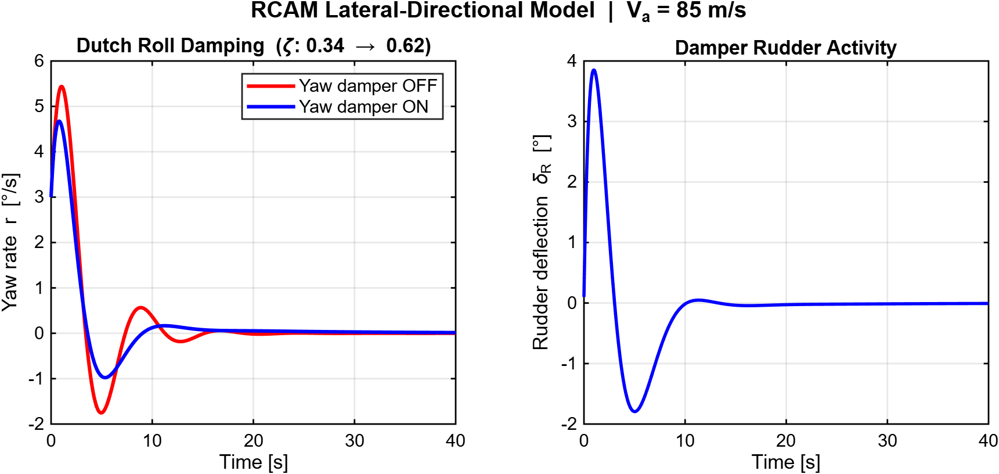
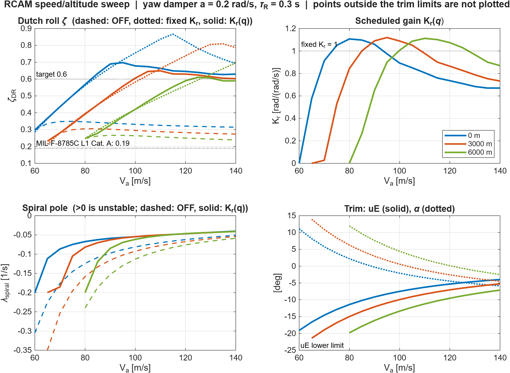
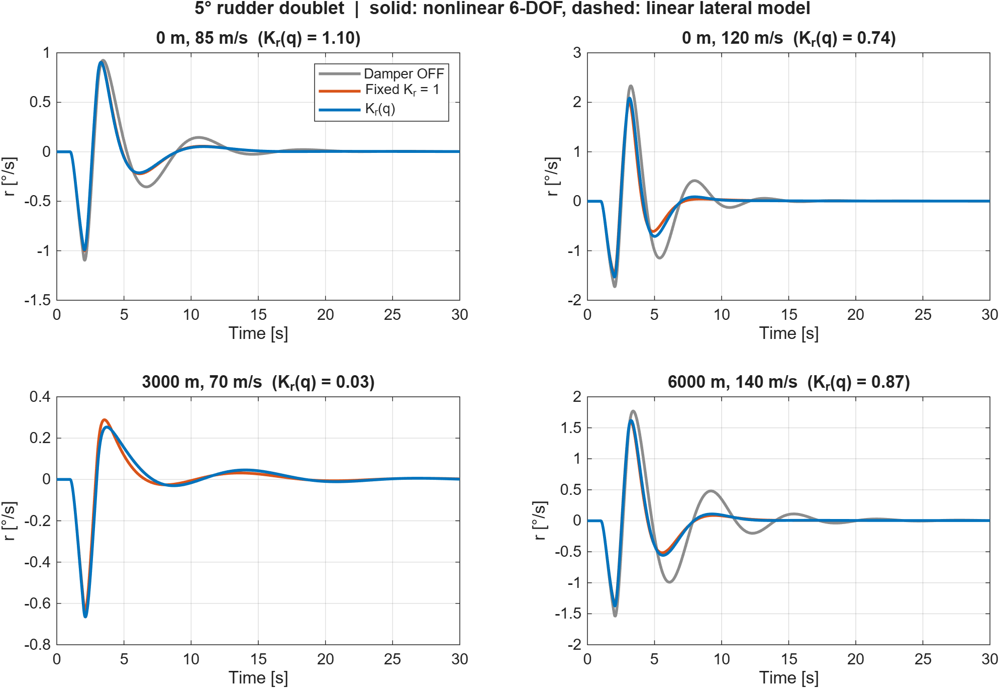
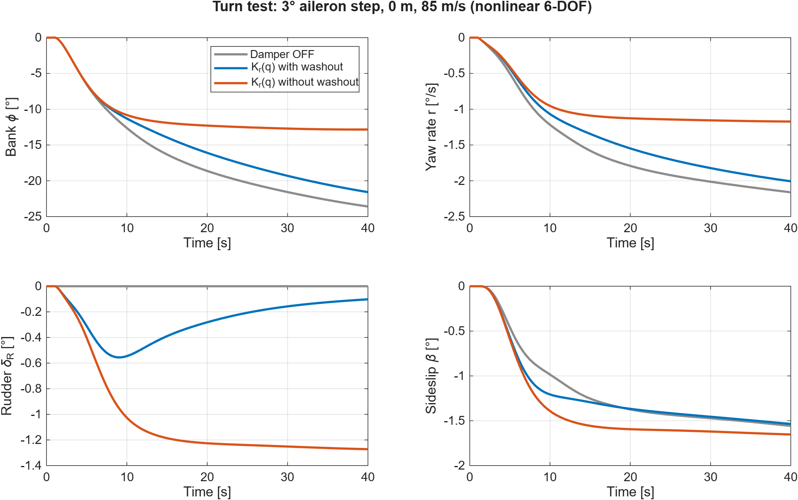
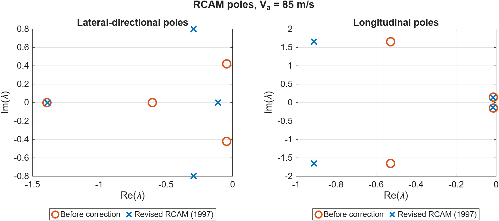

# RCAM Flight Dynamics

Nonlinear 6-DOF simulation, modal analysis and a gain-scheduled yaw damper
for the GARTEUR Research Civil Aircraft Model (RCAM), written in plain MATLAB.

This repository is the open-source core of an aircraft flight control
research project. This repository is the open-source core of an aircraft flight control
research project (working title *rcam-rta*: RCAM + Run-Time Assurance).
The run-time assurance part is not included here.

## Contents
- Nonlinear longitudinal and lateral-directional aircraft dynamics
- Trim solver for straight and level flight
- Linearization with a numerical Jacobian (A and B matrices)
- Analysis of the five flight modes (Dutch roll, roll subsidence, spiral,
  short period, phugoid)
- Yaw damper with a washout filter and rudder actuator dynamics
- Gain schedule on dynamic pressure, checked across a speed and altitude
  envelope and validated on the nonlinear model

## Why RCAM?
- **Civil and open.** RCAM describes a twin-engine wide-body transport of
  about 120 t. It was defined by GARTEUR Action Group FM(AG-08) as a
  benchmark for robust flight control design, so it is well documented and
  easy to cite.
- **Compact.** The whole model fits in about 40 coefficients, with no
  scanned lookup tables.
- **Nonlinear.** The model is coded once, and `rcam_trim` plus
  `rcam_linearize` then produce A and B matrices at any flight condition.

## Repository layout
```
model/
  rcam_params.m            Parameter set (mass, geometry, aerodynamic derivatives)
  rcam_dynamics.m          Nonlinear 6-DOF dynamics, xdot = f(x, u)
scripts/
  rcam_trim.m              Trim solver for straight and level flight (fminsearch)
  rcam_linearize.m         Central-difference Jacobian: A, B, Alat, Blat, Alon, Blon
  analyze_modes.m          Eigenvalues to mode table (wn, zeta, tau, T) and pole map
  yaw_damper_demo.m        Dutch roll with the damper off and on, saved as a PNG
  speed_sweep.m            Speed and altitude sweep of the lateral modes
  design_gain_schedule.m   Design of the yaw damper gain schedule Kr(qbar)
  yaw_damper_gain.m        Scheduled gain lookup, Kr = f(qbar)
  nonlinear_validation.m   6-DOF validation with rudder doublets and a turn
  main.m                   Driver script
tests/
  test_dynamics.m          Physical consistency tests (7 tests)
docs/
  yaw_damper.png             Output of yaw_damper_demo
  speed_sweep.png            Output of speed_sweep
  nl_doublet_5deg.png        nonlinear_validation, 5 deg doublet
  nl_doublet_10deg.png       nonlinear_validation, 10 deg doublet
  nl_turn.png                nonlinear_validation, turn test
  poles_old_vs_revised.png   Poles before and after the parameter correction
```

## Requirements
- MATLAB R2020a or newer (for `exportgraphics` and `tiledlayout`).
  No toolboxes are needed, only core functions such as `eig` and
  `fminsearch`.

## Quick start
From the repository root:
```matlab
addpath(genpath(pwd))
p = rcam_params;
[x_tr, u_tr] = rcam_trim(85, p);
[~,~,Alat,Blat,Alon] = rcam_linearize(x_tr, u_tr, p);
analyze_modes(Alat, Alon)
yaw_damper_demo                          % writes yaw_damper_slide.png to the current folder
yaw_damper_demo('docs/yaw_damper.png')   % regenerates the README figure
```

Tests:
```matlab
addpath(genpath(pwd))
test_dynamics
```

## Results at Va = 85 m/s, sea level
| Mode | Eigenvalue | wn [rad/s] | zeta |
|---|---|---|---|
| Dutch roll | -0.292 ± 0.800j | 0.851 | 0.343 |
| Roll subsidence | -1.387 (tau = 0.72 s) | - | - |
| Spiral | -0.109 (tau = 9.2 s) | - | - |
| Short period | -0.910 ± 1.651j | 1.885 | 0.483 |
| Phugoid | -0.015 ± 0.135j | 0.136 | 0.109 |

Trim: alpha = 0.86 deg, uE = -10.20 deg, uTH = 4.70 deg (both engines).

### Yaw damper
The control law is δR,cmd = Kr · s/(s + a) · r, and the rudder actuator is
modeled as 1/(τR·s + 1). Kr and a were chosen from the closed-loop
eigenvalues, with the actuator included, by sweeping Kr from 0.25 to 4 and
a from 0.05 to 1 rad/s.

| | Kr | a [rad/s] | τR [s] | Dutch roll zeta |
|---|---|---|---|---|
| Damper off | - | - | - | 0.34 |
| Damper on | 1.0 | 0.2 | 0.30 | **0.62** |

For an initial yaw rate of 3 deg/s, the peak rudder deflection is 3.9 deg.



### Speed and altitude sweep
`speed_sweep` trims and linearizes the aircraft from 60 to 140 m/s at 0,
3000 and 6000 m. Altitude is represented by the ISA density only, because
the RCAM atmosphere and engine model do not depend on altitude. The trim is
within limits (elevator, throttle, and alpha below 14.5 deg) at 46 of the
51 points. The points that fail lie in the low speed, high altitude corner.

- The open-loop Dutch roll damping is 0.23 to 0.35 across the valid
  envelope, so the MIL-F-8785C Level 1 minimums (0.08 for Categories B and
  C, 0.19 for Category A) are met everywhere.
- With the fixed gain Kr = 1, the damper raises zeta clearly at most points
  (up to 0.87). In the low speed, high alpha corner (0 m at 60 m/s and
  3000 m at 65 m/s) it **lowers** the damping, by up to 0.018.
- The spiral mode is stable everywhere. The washout damper slows the spiral
  down but never destabilizes it.

### Gain scheduling
`yaw_damper_gain(qbar)` returns Kr as a function of dynamic pressure, using
a linearly interpolated table. In straight and level flight
q̄ = W/(CL·S), so q̄ also fixes the angle of attack. That makes it a good
scheduling variable, since it combines speed and altitude into a single
number. The table is produced by `design_gain_schedule`:

- The **smallest** Kr that reaches zeta = 0.62 (0.6 plus a margin for
  interpolation) is chosen, so the rudder is not used more than necessary.
- Where the target cannot be reached, the smallest Kr that comes within
  0.005 of the best achievable zeta is chosen. This "do no harm" rule fades
  the damper out where it cannot help.

| q̄ [Pa] | 2210 | 2590 | 2990 | 3540 | 4100 | 4960 | 6020 | 8100 | 10760 |
|---|---|---|---|---|---|---|---|---|---|
| Kr | 0.00 | 0.58 | 0.91 | 1.08 | 1.12 | 1.06 | 0.90 | 0.76 | 0.67 |

Results over the 46 valid points:

| | Fixed Kr = 1 | Scheduled Kr(q̄) |
|---|---|---|
| Points where zeta drops below the open loop | 2 | **0** |
| Lowest zeta | 0.214 | 0.231 (equal to the open loop) |
| zeta range for q̄ ≥ 4500 Pa | 0.56 to 0.87 | 0.59 to 0.70 |
| Mean Kr for q̄ ≥ 4500 Pa | 1.00 | 0.87 |

**Important limitation.** At low q̄ and high alpha (alpha above roughly
9 deg), no choice of Kr or washout frequency adds meaningful damping.
Feeding back the stability-axis yaw rate (r·cos α - p·sin α) was also tried
and gained at most 0.008. The reason is that the directional stability
scales with (1 - α/15°), so the Dutch roll becomes roll dominated. Yaw rate
feedback to the rudder alone cannot damp it in this region; that requires a
multi-channel controller that also uses sideslip or the ailerons, such as
an LQR design.

```matlab
[qbar_bp, Kr_bp] = design_gain_schedule;   % regenerates the table
T = speed_sweep('docs/speed_sweep.png');   % fixed vs scheduled gain
```



### Nonlinear validation
`nonlinear_validation` tests the damper on the full 6-DOF model. The
integration uses RK4, the rudder actuator and washout are part of the
state, and Kr(q̄) is recomputed at every step from the current q̄. The test
uses 5 and 10 deg rudder doublets at four flight points, plus a turn. The
metrics are ∫r² and ∫β², each relative to the open loop.

| Point | Kr(q̄) | ∫r² ratio, fixed / scheduled | ∫β² ratio, fixed / scheduled |
|---|---|---|---|
| 0 m, 85 m/s | 1.10 | 0.74 / 0.72 | 0.61 / 0.59 |
| 0 m, 120 m/s | 0.74 | 0.56 / 0.64 | 0.48 / 0.57 |
| 3000 m, 70 m/s | 0.03 | **0.90 / 1.00** | **0.73 / 0.99** |
| 6000 m, 140 m/s | 0.87 | 0.55 / 0.59 | 0.46 / 0.49 |

- The nonlinear response matches the linear model closely. The normalized
  RMS error is at most 0.2 % for the 5 deg doublet and 0.7 % for the
  10 deg doublet, and the rudder never saturates. The linear results are
  therefore valid at these amplitudes.
- **Turn.** For a 3 deg aileron step, the damper with washout barely
  interferes with the turn. After 40 s the bank angle is -21.6 deg,
  compared with -23.6 deg with the damper off, and the steady rudder
  deflection is only -0.1 deg. Without washout, yaw rate feedback fights
  the turn: the bank stays at -12.8 deg, the yaw rate is 46 % lower, and
  the steady rudder deflection is -1.3 deg.
- **The schedule and sideslip.** At low q̄ (3000 m, 70 m/s) the fixed
  Kr = 1 reduces the sideslip energy by 27 %, even though the Dutch roll
  pole damping does not increase. The schedule only looks at the pole
  damping, so it gives Kr ≈ 0 there and misses this benefit. Using ∫β² as
  the only criterion is not a fix either. It picks the largest gain
  everywhere (the upper end of the sweep, Kr = 3) and lowers zeta from 0.63
  to 0.45 on average at high q̄, with a worst case of 0.193, just above the
  MIL Category A limit of 0.19. The schedule therefore stays based on pole
  damping, and the trade-off between sideslip and damping is left to the
  LQR step, where sideslip is a state.




### Effect of the parameter correction
Correcting the moment coefficients against TP-088-3 (the angle of attack
dependence of the yawing moment, and the tail scaling of Cm_q and Cm_dE)
moved the lateral-directional poles substantially. The Dutch roll damping
went from 0.10 to 0.34, and the spiral time constant from 1.7 s to 9.2 s.



## Verification
- Physical consistency tests in `tests/test_dynamics.m` (7 of 7 pass)
- Moment equations compared with TP-088-3 Version 1 (1995), equation 2.33
- The phugoid is within 17 % of the Lanchester approximation
  ωn ≈ √2·g/V = 0.163 rad/s, which ignores drag and compressibility
- In symmetric trim the longitudinal and lateral dynamics decouple
  exactly (the cross-coupling terms of A are zero)
- The modal structure can be cross-checked against independent RCAM
  implementations

## Known limitations
- The kinematics use Euler angles and are singular at θ = ±90 deg.
- The air data are undefined at Va = 0 (the model returns NaN), so the
  model is not valid at very low speed.
- Actuator dynamics are modeled only for the rudder in the yaw damper
  studies (`tau_R`). The other surfaces and the bare nonlinear model have
  no actuator dynamics.
- The nonlinear validation covers four flight points and one turn.
  Turbulence, engine failures and large bank angles have not been tested.
  `yaw_damper_demo` still uses the fixed Kr = 1, which is close to the
  scheduled value of 1.10 at 85 m/s.
- In the low q̄, high alpha corner a rudder-only damper cannot add
  damping (see Gain scheduling).
- Constant air density by default, and no wind or turbulence.

## Parameter source and verification notes
The model follows the **revised RCAM definition (February 1997)** as it
appears in common open implementations: a cubic CL curve in the stall
region, c̄ as the reference length for all moments, and a centre of
gravity at Xcg = 0.23c̄, Zcg = 0.10c̄. The parameter values were taken
from, and cross-checked against, two independent open implementations
(PSim-RCAM and an RCAM_model.m implementation, see References). The 1997
document itself has not been consulted.

The moment coefficients were checked against TP-088-3 Version 1
(15 June 1995), published by GARTEUR, equation 2.33:
- Yawing moment: Cn = (1 - α·180/(15π))·β + ...
- Pitch damping: -4.03·St·lt²/(S·c̄²)
- Elevator power: -3.1·St·lt/(S·c̄)

The 1995 version differs from the revision in several places. It has no
stall curve, it scales the roll and yaw moments by the wingspan
b = 44.8 m, it uses a different sign for I_xz and for the engine
positions, and it gives the centre of gravity only as an uncertainty
range. This repository uses the 1997 definition. A line-by-line check
against the 1997 document itself is still open.

## References
- GARTEUR FM(AG-08), *Robust Flight Control Design Challenge Problem
  Formulation and Manual: the Research Civil Aircraft Model (RCAM)*,
  TP-088-3, Version 1, 15 June 1995.
  [garteur.org](https://garteur.org/wp-content/reports/FM/FM_AG-08_TP-088-3.pdf)
- PSim-RCAM, a Python implementation of the RCAM flight dynamics.
  [github.com/flight-test-engineering/PSim-RCAM](https://github.com/flight-test-engineering/PSim-RCAM)
- Aircraft-Simulation-Control, an RCAM_model.m implementation.
  [github.com/dongwoo0813/Aircraft-Simulation-Control](https://github.com/dongwoo0813/Aircraft-Simulation-Control)
- MIL-F-8785C, *Flying Qualities of Piloted Airplanes*, 1980. The Dutch
  roll damping limits quoted here (Level 1) have not been re-checked
  against the standard in this repository.

## Further reading (not yet consulted)
- GARTEUR TP-088-3, revision of February 1997.
- Looye & Bennani, *Description and Analysis of the Research Civil
  Aircraft Model (RCAM)*, GARTEUR TP-088-27, 1997.
- Magni, Bennani & Terlouw (eds.), *Robust Flight Control: A Design
  Challenge*, LNCIS 224, Springer, 1997.

## License
Apache License 2.0 (see LICENSE). Copyright 2026 1337leets.
